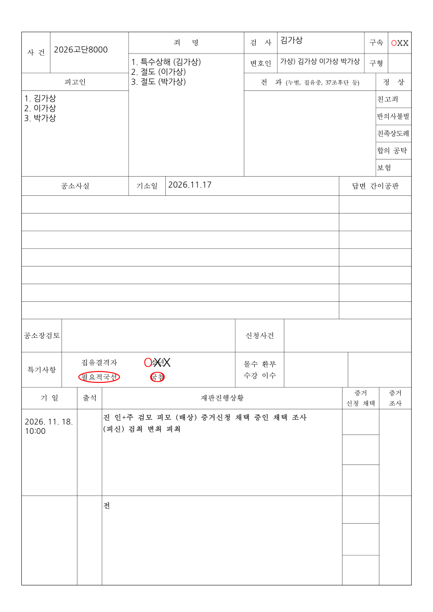
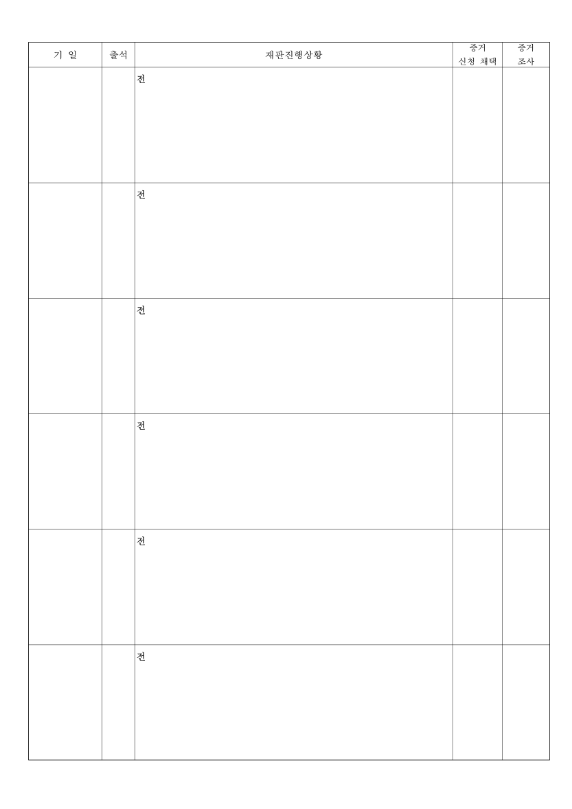
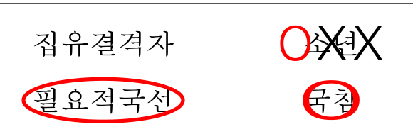
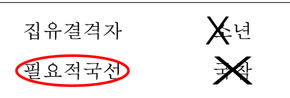

# 새 2페이지 원본·전체 저장·본문 기소일 수정

기준 `experiment/v1-download-juvenile-jury` / `44a0d39`에서
새 브랜치 `experiment/v1-batch-save-filing-date`로 작업했다. 기존 정상 버전은 보존한다.
사용자는 이전 버전의 분석·2페이지 생성·소년/국참 표시가 회사 Edge 104에서 동작함을 확인했다고 보고했다.
이번 변경과 회사 폴더 정책의 개발 환경 직접 검증 범위는 아래와 같다.

## 제공 원본 확인과 단일 양식 내장

첨부 파일의 실제 이름은 `형사메모.pdf`였고, 실제로 열어 **595 × 841pt의 2페이지**임을 확인했다.
본문의 새 특기사항·첫기일 위치도 사용자 설명과 일치해 개발 원본을 `templates/형사메모(1).pdf`로 보존했다.
업로드와 개발/배포 원본 바이트는 동일하며 SHA-256은
`d4cfd5a2ea5b3929c0c44f80a3518d22e5f4e44fe6589d9a8d32382e0bd2e72b`이다.

빌드는 이 파일 하나만 HTML에 base64 내장한다. 별도 `secondTemplate` 리소스와
1쪽+2쪽 `copyPages` 병합 경로를 제거했다. 렌더러는 원본이 정확히 2페이지인지 확인하고
첫 페이지에만 덧입힌다. 두 번째 페이지에는 어떤 draw 호출도 하지 않는다.
기존 배포 양식 파일들을 정리하고 배포 templates 폴더에도 새 원본 하나만 넣는다.
기존 브랜치/원본 이력은 보존하고, 실행 중 별도 양식 파일 선택이나 외부 파일 읽기는 요구하지 않는다.

## 모든 출력 위치 재측정

원본 두 페이지를 실제 렌더링하고 PyMuPDF의 글자 bbox와 표 선 경로를 읽었다.
좌표는 **왼쪽 위 기준 pt, `[x,y,width,height]`**이다. 상단 칸의 경계가 동일한 경우에도 새 원본에서 재확인했다.

| 항목 | 기존 출력 박스 | 새 출력 박스 | 재측정 결과 |
|---|---|---|---|
| 사건번호 | [74,61,97,27] | [74,61,97,27] | 셀 x69.203..176.665, y43.872..100.570 안에 맞음 |
| 피고인 | [33,128,140,111] | [33,128,140,111] | 셀 x29.744..176.665, y124.784..242.495 안에 맞음 |
| 죄명 | [180,78,151,161] | [180,78,151,161] | 셀 x176.665..335.220, y73.599..242.495 안에 맞음 |
| 검사 | [385,48,112,22] | [385,48,112,22] | 셀 x381.275..500.731, y43.872..73.599 안에 맞음 |
| 변호인 | [385,78,112,20] | [385,78,112,20] | 셀 x381.275..500.731, y73.599..100.570 안에 맞음 |
| 구속 OX | [537,48,25,22] | [537,48,25,22] | 셀 x533.353..565.496, y43.872..73.599 안에 맞음 |
| 기소일 | [231,247,174,20] | [231,247,230,20] | 새 값 셀 x227.518..465.829, y242.495..268.986에 맞춰 폭 확장 |
| 첫기일 | [34,548,67,42] | [34,573,67,44] | 새 표 첫 행 셀 x29.744..106.263, y562.305..681.455 안에 두 줄 |
| 소년 OX | [169.398,730.367,36,14] | [198.243,491.310,36,14] | 새 소년 글자 중심 (216.243,498.310) |
| 국참 OX | [174.398,746.430,26,14] | [203.243,511.328,26,14] | 새 국참 글자 중심 (216.243,518.328) |
| 필요적국선 원 | [109,746,56,15] | [108.246,510.828,56,15] | 새 글자 중심 (136.246,518.328)에 맞춤 |

새 인쇄 글자 bbox는 소년 `[206.288,493.334,19.909,9.952]`, 국참
`[206.288,513.352,19.909,9.952]`, 필요적국선 x111.300..161.192, y513.352..523.304다.
이전 auto-fit 방식·색상·판정은 그대로 두고 참조 rect만 새 위치로 옮겼다.
실제 O/X 획은 인쇄 글자를 덮는 크기이며, 복수 문자열·미확정 공백의 순서와 중앙 정렬도 유지한다.
첫기일은 기존 표기대로 `2026. 11. 18.`와 `10:00`의 두 줄이며 새 첫 기일 칸 안에 들어간다.

기존 소년·국참·필요적국선 영역과 기존 첫기일 시작 위치에는 새 입력이 남지 않음을
원본/출력 픽셀 비교로 검사했다. 출력 영역 외 픽셀 차이는 0이고, 원본 표/벡터 경로도 동일하다.

## 전체 메모 저장과 상태 분리

`전체 메모 저장`은 폴더 선택 여부와 관계없이 생성된 PDF가 있으면 사용할 수 있다.
폴더가 없으면 그 버튼의 사용자 동작에서 picker를 호출하고, 사용자가 선택·허용한 폴더에 전체를 순차 기록한다.
이미 폴더를 선택했다면 한 번의 클릭으로 전체 저장을 수행한다. 자동 다중 다운로드나 ZIP으로 대체하지 않는다.

파일별로 원본 이름·사건번호·생성 상태·추출 실패 항목 이름·저장 상태/실패 사유를 표시한다.
`generationState`, `missingFields`/추출 경고, `saveState`/`saveError`를 별도로 관리한다.
다운로드 요청은 폴더 저장 성공으로 세지 않는다.

- 각 `write`와 `close` 완료를 기다린 뒤 해당 파일만 `saved`로 바꾼다.
- 일부 파일 실패는 해당 행에 표시하고 다음 파일을 계속 처리한다.
- 같은 폴더에 현재 입력으로 이미 저장한 건은 중복 기록하지 않는다.
- 기존 파일이 발견되면 쓰기 스트림을 열지 않고 충돌 오류를 표시한다. 덮어쓰기/삭제하지 않는다.
- 실패한 행의 `이 메모 폴더 저장`으로 개별 재시도한다. 필요하면 다른 폴더를 선택할 수 있다.
  실제 파일 생성 뒤 쓰기가 실패하여 빈 파일이 남은 경우에도 기존 파일로 보호하므로 다른 폴더를 사용할 수 있다.
- 저장 동안 입력을 잠그고, 방어적으로 revision도 확인해 이전 입력의 파일을 현재 결과로 표시하지 않는다.
- 폴더 미지원·차단은 보류/실패 사유를 보여 주며 기존 다음 메모/사건별 다운로드를 유지한다.
  취소나 요청만으로 저장 완료를 표시하지 않는다. 브라우저 보안 정책을 변경하지 않는다.

요약: 전체 공소장 수, 메모 생성 성공 수, 실제 폴더 저장 성공 수, 저장 실패 수,
추출 경고 사건 수를 표시하며 생성 실패와 미저장/보류 수도 별도로 제공한다.

Chromium 103의 선택 핸들 모의 시험에서:

| 시나리오 | 결과 |
|---|---|
| 폴더 미선택 상태에서 전체 저장 1회 | picker 1회, 사용자 활성 상태에서 호출, 10개 파일 순차 저장 |
| 첫 파일 close를 일부러 지연 | close 전 저장 성공 0개, 입력 잠김, close 후에만 증가 |
| 중간 1개 쓰기 실패 | 성공 9 / 실패 1, 뒤 파일까지 계속 저장 |
| 실패 건 개별 재시도 | 성공 10 / 실패 0, 추출 경고 필드 그대로 |
| 이미 저장한 현재 결과 재요청 | 중복 write 없음 |
| 미리 존재하는 파일 충돌 | 해당 파일 불변, 나머지 9개 저장 |
| 폴더 쓰기 권한 거부 | 저장 실패로 표시, 성공으로 집계하지 않음 |
| 보안 컨텍스트가 아닌 최신 브라우저 메모리 진단 | 폴더 접근 거절, 성공 0, 개별 다운로드 가능 |

모의 핸들은 전체 PDF 바이트 일치와 쓰기/닫기 순서를 확인한다.
**실제 회사 Edge 104의 네이티브 폴더 선택·쓰기 권한 정책은 직접 검증하지 못했다.**
File System Access API 자체를 우회하지 않았으며, API의 원자적 create-exclusive 부재 등 기존 제한은 그대로다.

## 본문 기소일 우선

기존은 `submission` 후보가 본문과 다르거나 읽히지 않으면 유효한 본문 날짜도 무효화했다.
이번에는 제출일시·다운로드일시를 후보로 수집하지 않으며, 해당 머리말은 본문 판단에 관여하지 않는다.

1. 명시적 기소일/기소일자/공소제기일 항목을 우선한다.
2. 없으면 검찰청 명칭 아래의 공소장 본문 날짜를 사용한다. 기존 일반 문서의 안전한 상단 문맥도 유지한다.
3. 선택한 우선순위 안에서 날짜가 충돌하거나 읽을 수 없으면 보류한다.
4. 본문 날짜가 없으면 제출일시로 대체하지 않는다. 범죄일시·구속일·체포일도 대체 근거가 아니다.

| 재현 자료 | 기존 44a0d39 | 수정 |
|---|---|---|
| 본문 2026-11-10 / 제출 2026-11-12 | 보류: 본문과 제출 날짜 다름 | **2026-11-10** |
| 본문 2026-11-17 / 제출 2026-11-19 | 보류 | 실제 생성 PDF에 **2026.11.17** 출력 |
| 제출만 있고 본문 근거 없음 | 보류 | 보류 유지 |
| 본문 후보 2개 충돌 | 보류 | 보류 유지 |

같음/늦음/빠름/다른 다운로드일/제출 없음/일반 문서/본문 충돌/제출만 존재/반복 머리말을 검사했다.
명시적 날짜 우선, 명시적 후보끼리 충돌, 읽지 못한 제출 메타데이터, 생일 경계에 제출일 대신 본문 날짜가
나이 판정까지 전달됨도 추가 검사했다.

## 검증 결과와 보존

- 단위 검사 **199개 통과**. 이전 제출일 충돌 차단 검사는 새 요구에 맞게 변경했다.
- Edge 104 legacy·사전 폴리필·새 원본 전체 내장 검사 **3개 통과**.
- Linux Chromium 103의 실제 오프라인 file URL에서 전체 UI·다운로드·폴더 모의 저장 회귀 통과.
- 최신 Chromium에서 Promise.withResolvers 등 API를 제거한 회귀도 통과.
  최신 환경은 file URL이 관리 정책에 막혀 동일 HTML의 메모리 진단으로 명시했다.
- 환경마다 다운로드 PDF 54개와 실제 양식/획 분리 진단 PDF 24개, 총 78개를 독립 PyMuPDF로 검사했다.
- 독립 검사 **각 768개 통과**: 항상 2페이지, 두 번째 페이지의 크기/회전/스트림/텍스트/글꼴/좌표/전체 픽셀 원본 동일,
  11개 출력 위치, 인쇄된 글자를 덮는 OX의 크기·중앙·색상·빈칸, 원본 표/경로/비기재 영역 보존,
  기존 위치의 불필요한 표시 없음, 변호인 26개 형식의 전체 이름, 부분 추출 빈칸,
  기존 실제 샘플 2개와 이미지/혼합 OCR을 확인했다.
- 두 페이지 전체와 새 특기사항을 실제 렌더링하고 직접 시각 확인했다.

검사·피고인·죄명·변호인·구속 파서, PDF 입력/추출/OCR/다운로드 서비스 본문,
파일명/첫기일 검증/기존 단건 저장 primitive는 기준 커밋과 바이트 단위로 동일함을 비교했다.
나이·소년·국참 판정은 변경하지 않았다. 주요 변경은 새 원본/좌표, FilingDateParser,
상태·요약·일괄 저장 orchestration이다. 첫기일 외 수동 입력은 추가하지 않았다.

보고서: `batch-save-form-chromium103-*-report.json`, `batch-save-form-missing-api-*-report.json`,
`new-template-chromium103-layout-report.json`, `new-template-missing-api-layout-report.json`.
시험한 HTML의 SHA-256을 기록한다. 가상 자료와 기존 샘플이 최신 실제 공소장 전부의 정확도를 보장하지는 않는다.
Actions ZIP은 프로그램 배포용이며 생성 메모 PDF는 ZIP으로 묶지 않는다.
