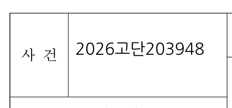
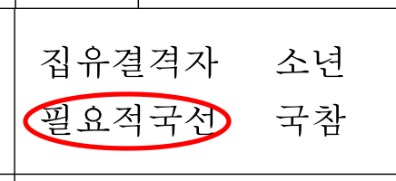
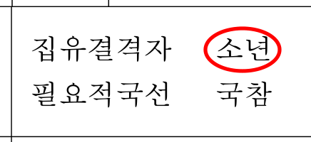

# 사건번호·일괄 생성·표시 규칙 확장

기준 `experiment/v1-first-hearing` / `742c8f7`에서 새 브랜치
`experiment/v1-batch-case-number`로 개발했다. 기존 첫기일 브랜치는 보존한다.

## 사건번호, 첫기일, 파일별 처리

- 파일명을 NFC 정규화한 뒤 `(20\d{2})(고단|고정)(\d+)`로 사건표시를 추출한다.
  법원명·뒤 문구·확장자는 없어도 된다. 없거나 서로 다른 사건번호가 여러 개면 제외한다.
  공소장 본문의 검찰/법원 사건번호를 출력 값으로 대체하지 않는다.
- 원본 PDF를 렌더링하고 선을 읽어 사건 칸 오른쪽 빈 셀을 확인했다.
  셀은 x=69.203..176.665, y=43.8721..100.5701pt, 신규 출력 박스는
  `boxes.caseNumber=[74,61,97,27]`이다. 기존 사건 글자·표 선은 보존한다.
- 파일 수만큼 원본명·사건표시·날짜/시간·처리 상태·오류를 표시한다.
  첫 번째 날짜 입력 이벤트가 나머지 날짜를 모두 복사하며, 시간은 복사하지 않는다.
- 날짜 `YYYY-MM-DD`, `YYYYMMDD`, 점 구분 날짜를 지원한다. 시간은 `HH:mm`, `HHmm`.
  출력은 `YYYY. M. D.`와 `HH:mm` 두 줄. 저장 이름은 `HHmm 사건표시.pdf`로 날짜를 제외한다.
- 새 UI는 파일별 날짜·시간이 모두 필수이다. 시간 없는 파일을 저장 이름 추측으로 생성하지 않는다.
  한쪽만 입력·잘못된 날짜/시간은 그 행에 오류로 표시한다.
- 문서는 순차 처리하고 파일별 예외를 격리한다. 오류 파일은 생성 대상/ZIP에서 제외하며 이후 파일을 계속 처리한다.
- 첫기일 편집 시 해당 결과를 무효화하고, 처리 중 revision이 바뀌면 이전 결과를 게시하지 않는다.
- 다중 선택이면 성공 PDF들을 `criminal-memo-batch.zip` 하나로 저장한다. 단일 선택은 PDF 저장.
  이름 충돌은 오류로 처리하며 ZIP 파일을 덮어쓰지 않는다. fflate 0.8.2를 잠금 버전으로 번들링했다.
  사용자 실행 시 네트워크/설치/서버/추가 worker 파일을 요구하지 않는다.

## 나이·필요적국선·구속

- 70세 **이상** 또는 누구라도 구속이면 필요적국선에 빨간 투명 타원을 **한 번** 표시한다.
- 확정 가능한 나이가 19세 미만이면 소년에 표시한다. 복수 피고인은 조건을 OR로 합친다.
- YYMMDD만으로 세기를 정하거나 주민번호 뒷자리·기재 나이·임의의 최대 나이로 추정하지 않는다.
  이 경우 나이 기반 동그라미는 계속 보류한다. **구속에 따른 필요적국선 표시는 별개로 적용한다.**
- 세기를 확정하는 지원 문맥은 해당 피고인의 `생년월일` 항목에 실제로 명시된 전체 연월일이다.
  기존 날짜 형식으로 파싱되는 모든 근거가 유효하고 하나로 일치하며, 앞 6자리와 맞고 기소일 이후가
  아니고 OCR 검토 필요 상태가 아닌 경우에만 계산한다. 모순·잘못된 근거는 보류한다.
  전체 생년월일을 추가 수동 입력하는 UI는 없다.
- `구속여부.`도 항목 경계로 인식한다. 명시적 불구속은 X, 날짜 + 구속(체포일) 지원 표기는 빨간 O.
  고정 사건이고 항목이 **아예 없을 때만** X로 기본 처리한다. 빈 값·미상·서로 충돌한 값은 보류한다.
  다른 사건분류의 누락은 불구속으로 가정하지 않는다.

## 검증

- 기존 파서·호환성·첫기일 107개를 유지하고 신규 24개를 더한 **131개 단위 검사 통과**.
- 완성 HTML의 Edge 104/legacy/사전 폴리필 검사 **2개 통과**.
- Linux Chromium 103.0.5058.0의 실제 file URL + native offline 실행.
- Chromium 156에서 Promise.withResolvers 등 API를 명시적으로 제거한 실행.
  해당 실행의 file URL은 관리 정책으로 차단되어 동일 HTML의 메모리 진단을 수행했다.
- 10개 가상 PDF 동시 업로드 → 날짜만 복사 → 시간별 생성 → ZIP 다운로드.
  내부 PDF 10개와 UTF-8 한글 이름·CRC·실제 바이트 일치를 검증했다.
- 날짜/시간 부분·유효성 오류, 사건번호 누락, 손상 PDF 뒤의 정상 파일 처리, 이름 중복 방지,
  단일 PDF 정확한 이름, 입력 변경 후 무효화 및 분석 중 편집에 따른 이전 결과 폐기를 검사했다.
- 70세 생일 당일/전날, 19세 생일 당일/전날, 세기 불확실성, 모순 DOB 근거, OCR 상태,
  구속 날짜·체포일·마침표 항목, 고정 누락/명시적 빈 값, 복수 피고인 OX/XX/OO를 검증했다.
- 기존 실제 PDF 2개의 추출 결과를 기존 텍스트 회귀 fixture와 대조하고 실제 PDF를 생성했다.
  국선·일반·법무법인 26개 형식의 자동 추출 및 최종 PDF 출력도 검증했다.
- 이미지 전용 PDF와 text/image 혼합 PDF의 OCR 회귀가 통과했다. 기존 OCR 검토 필요 정책 유지.
- `scripts/verify_batch.py`의 **195개 검사**가 각 환경에서 통과했다. 실제 브라우저 다운로드/ZIP 멤버를 독립 PyMuPDF로 검사한다.
  사건·첫기일·구속 문자열/색상, 필요적국선/소년 타원의 개수·위치·투명성,
  피고인/변호인 전체 이름과 순서, 원본 비기재 영역의 변경 픽셀 0을 확인한다.
- 모든 실행의 외부 HTTP 요청과 페이지 오류는 0이다.

보고서 파일:
`batch-chromium103-browser-report.json`, `batch-chromium103-pdf-report.json`,
`batch-missing-api-browser-report.json`, `batch-missing-api-pdf-report.json`.

## 보존 및 한계

검사·기소일·죄명·국선/법무법인 이름 파서의 본문, PDF 입력/텍스트 추출/OCR 구현,
원본 PDF·글꼴·OCR 데이터, Edge 104 legacy 빌드 설정을 보존했다.
주요 변경은 파일별 UI/ZIP, 사건 표시, 첫기일 정규화, 생년월일 근거 판정과 구속/표시 규칙이다.
수동 입력은 파일별 첫기일 날짜·시간으로 한정한다.

실제 회사 Windows Edge 104.0.1293.47과 사용자의 최신 실제 공소장 전체는 미검증이다.
구형 Linux 엔진의 software GL 설정은 개발용이며 회사 PC에 추가 설치나 보안 해제를 요구하지 않는다.
가상·기존 샘플의 성공을 모든 실제 공소장 정확도 보장으로 해석하지 않는다.
