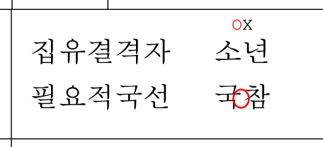
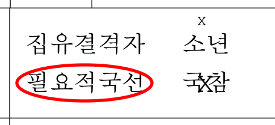
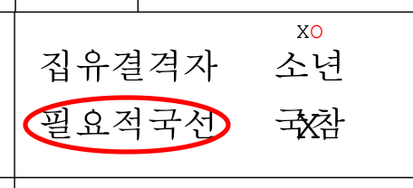
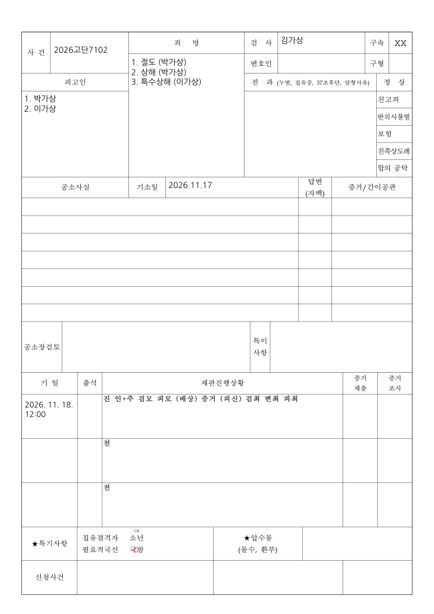
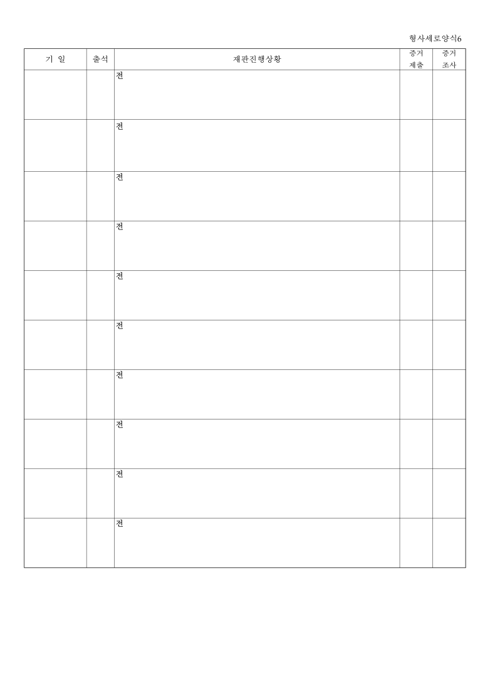

# 다운로드·피고인별 소년 OX·국참 검증

기준 `experiment/v1-two-page-memo` / `b53ac20`에서
`experiment/v1-download-juvenile-jury`로 분기했다. 기존 브랜치는 보존한다.

## 다운로드 원인 분석과 변경

기준 버전의 `app.js`는 전체 버튼 한 번의 클릭에서 모든 Blob 다운로드 링크를 연속 클릭한다.
`PDFExportService.download`에는 저장 성공을 확인하는 반환값이 없고 Blob URL은 **60초 후**에 해제된다.
따라서 즉시 URL 해제가 첫 파일을 없애는 경로는 아니다. 생성 완료와 실제 브라우저 저장은 별개다.

개발용 Chromium 103의 기준 버전 실제 HTML에 2개 가상 PDF를 넣어 확인했다.
두 메모 모두 생성되었고 두 다운로드 호출에 각각 올바른 파일명, 781KB 이상 바이트와 `%PDF` 헤더가 전달되었다.
개발 시험 중 두 다운로드 이벤트가 모두 수신된 실행도 있어 회사 PC의 첫 파일 누락 현상 자체는 재현하지 못했다.
이전 검증에서도 일부 다중·반복 요청이 수신되지 않은 기록이 있고, 이번 반복 다운로드 진단에서도
브라우저가 이벤트를 주지 않는 경우가 있었다. 실제 회사 Edge에서 차단/취소의 정확한 내부 사유는 미검증이다.
호출 성공만으로 저장 성공을 알 수 없고 브라우저 정책·환경에 따라 결과가 달라지는 경로를 제거했다.

- 전체 자동 링크 클릭을 제거하고 **다음 메모 다운로드**로 바꿨다.
- 버튼을 한 번 누를 때 아직 요청하지 않은 메모 **한 개**만 사용자 동작 안에서 요청한다.
- 파일 순서와 진행 개수를 표시하고, 전부 요청하면 버튼을 비활성화한다.
- 요청 여부는 완료 여부가 아니다. 저장 확인은 브라우저에서 하도록 안내한다.
- 각 사건의 **이 메모 다운로드**는 요청 후에도 남아 재시도할 수 있다.
- ZIP 생성 함수나 라이브러리를 추가하지 않는다. Blob URL 해제 정책도 불필요하게 바꾸지 않았다.
- 폴더 선택/권한이 있으면 전체를 순차 저장한다. 각 `write`와 `close`를 기다린 후에만 완료로 표시한다.
  일반 파일 쓰기 오류는 해당 사건에 사유를 표시하고 다음 파일을 처리한다.
  폴더 권한 상실은 실패한 파일과 남은 보류 파일을 구분하여 개별 다운로드를 안내한다.
- 기존 파일 충돌 검사를 유지하며 원본을 덮어쓰거나 삭제하지 않는다.

브라우저의 다중 다운로드 허용 설정이나 보안 정책을 변경·우회하지 않았다.

## 주민번호와 기소일 기준 나이

기존의 명시적 전체 생년월일 근거 방식은 요청에 따라 폐지했다.
`DefendantParser`가 동일 피고인의 신원 영역/주민등록번호 필드에서 앞 6자리와 세기 숫자를 추출해
`birthDigits`, `birthCenturyDigit`로 전달하고 `birthAssessment()`가 이를 사용한다.

- 첫 숫자 1·2: 1900 + YY, 3·4: 2000 + YY.
- 하이픈 앞뒤 공백 및 앞/뒤 부분 사이 줄바꿈, 별도 주민등록번호 필드를 지원한다.
- 등록번호 형식의 앞 6자리와 뒤 7자리(숫자/마스킹 문자) 전체가 있어야 한다.
  뒤의 나머지 여섯 자리는 내용과 무관하며 모두 가린다. 길이가 잘린 토큰을 정상 번호로 보정하지 않는다.
- 첫 숫자 누락·1~4 외 숫자·서로 다른 첫 숫자·유효하지 않은 생일·미래 생일·기소일 실패는 보류한다.
- 기재 나이나 별도 생년월일 항목으로 이 조건을 대체하지 않는다.
- OCR 검토 필요 생년월일은 기존 보수적인 보류를 유지한다. OCR 엔진과 설정은 변경하지 않는다.
- 생일이 지났는지 기소일과 비교해 만 나이를 계산한다. 첫기일 날짜는 계산에 쓰지 않는다.
- 19세/70세 생일 당일 포함 경계와 1900/2000년 윤년 차이를 검사했다.

개인정보 최소화: PDF 텍스트 반환 단계와 OCR 결과를 합치는 단계에서 뒤 여섯 자리를 가린다.
직접 파서 호출에도 마스킹을 적용한다. 앱의 추출 텍스트, 구조화 결과, 로그/보고서, 생성 메모에
그 여섯 숫자를 남기지 않으며, 이름/주소 등의 다른 정보를 로그에 새로 추가하지 않는다.
원본 PDF는 그대로 미리보기하며 수정하지 않는다. 이 마스킹은 원본 파일을 재작성하는 기능이 아니다.
가상 숫자 뒷부분을 동적으로 조합한 입력으로 UI 추출 텍스트·반환값·출력·진단에 잔존하지 않음을 확인했다.

## 소년 OX와 필요적국선

`juvenileGlyphs()`는 피고인 순서대로 만 19세 미만 빨간 O, 만 19세 이상 검정 X,
나이 미확정이면 한 칸 공백을 반환한다. 전체 사건에 원/X 하나를 찍던 출력을 제거했다.
빈칸을 제거하거나 다른 피고인의 나이를 섞지 않는다.

원본 PDF를 렌더링하고 글자/선 좌표를 확인했다.

- 하단 표 윗선 y=722.330pt, 인쇄된 소년 글자 y=732.124..742.611pt.
- 그 사이 빈 공간에 `boxes.juvenile=[168,723.5,39,8]`을 설정했다.
- Courier 글꼴을 칸에 맞게 축소하고 한 줄에 출력한다. 일반 사례는 6.25pt,
  실제 글자 bbox y=723.597..731.403pt로 표 선과 소년 글자에 닿지 않는다.
- 단위 검사에서 1·2·3·4·10명 순서/빈칸을, 실제 PDF에서는 1·2·3·4명의 표시와 색상·좌표를 검증했다.
- 필요적국선은 누구라도 확정 만 70세 이상 또는 구속이면 기존 빨간 원을 한 번 표시한다.
  구속 OX의 추출·색상·순서·출력 로직은 변경하지 않는다.

## 국참 분류

기존 ChargeParser의 죄명 목록을 그대로 사용한다. NFC·공백·괄호 모양/공백을 정규화한 뒤
다음 **정확한 전체 문자열**을 비교한다.

- 특수상해
- 특수공갈
- 특정범죄가중처벌등에관한법률위반(도주치상)
- 특정범죄가중처벌등에관한법률위반(도주치사)

대상이 하나라도 확인되면 다른 피고인의 정보가 불완전해도 빨간 O를 한 번 표시한다.
그 외에는 모든 피고인의 죄명 필드가 추출되고 명백한 불완전 표지가 없을 때만 검정 X다.
누락·빈 값·판독불가·미상·깨진 괄호·끝 쉼표·생략 표지·대상 명칭의 잘린 접두부·OCR 검토 필요 등은
별도 `chargesComplete` 메타데이터로 보류한다. 실제 죄명 파서 반환 목록을 바꾸지 않는다.
공소사실/적용법조를 대상으로 다시 검색하거나 '특수상해미수' 등을 부분 일치시키지 않는다.

인쇄된 국참 bbox는 x=177.384..197.413, y=748.187..758.673pt이다.
`boxes.jury=[174,746,26,15]`, 중심 x=187pt에 12pt Courier O/X를 겹쳐 출력한다.
실제 glyph bbox는 y=746.006..760.994pt이며 필요적국선과 소년 영역에 겹치지 않는다.
UI와 사용자 설명서에서 지정 죄명에 따른 자동 분류이며 최종 법적 판단이 아님을 표시한다.

## 검증 및 보존

- 요청에 반대되는 이전 나이 정책 검사는 새 정책 검사로 대체했다. 나머지 검사·기소일·죄명·변호인·구속·첫기일
  회귀를 포함한 단위 검사 **166개 통과**.
- 완성 HTML의 Edge 104 legacy/사전 폴리필 및 두 원본 내장 검사 **3개 통과**.
- 실제 Linux Chromium 103의 오프라인 file URL에서 2건/10건의 다운로드를 각각 확인한다.
  한 클릭당 요청 수=1, 이름·바이트·생성 상태를 직접 검증한다.
- 폴더 10건의 바이트 일치·쓰기/닫기 순서·충돌·중간 실패 후 계속 진행·권한 상실은
  사용자 선택을 재현한 모의 picker/handle로 검증한다. 네이티브 회사 폴더 저장 시험은 아니다.
- 최신 Chromium에서 Promise.withResolvers 등 API를 제거한 시험을 추가한다.
  관리 정책에 의해 file URL 또는 다운로드가 차단되면 보고서에 메모리 진단으로 명시한다.
- 단건/다건 2페이지, 부분 추출 생성, 손상/사건번호 실패 격리, 날짜 복사와 시간 독립,
  수정 후 무효화·분석 중 수정 폐기, 기존 실제 샘플 2개의 파서 결과, 변호인 26개 형식, 이미지·혼합 OCR 회귀.
- 독립 PyMuPDF로 **54개 PDF / 550개 검사**: 모든 출력이 2페이지,
  두 번째 페이지 내용 스트림·글자·좌표·회전·크기·전체 픽셀 원본 동일.
  소년 OX/빈칸의 위치·색상·크기·순서, 국참 정확한 겹침, 필요적국선 원 개수,
  새 표시 영역 외 첫 페이지가 b53ac20의 실제 HTML 렌더러와 픽셀 동일함을 확인한다.
- 두 페이지 전체와 하단 표시를 렌더링해 시각 확인한다.

기존 두 양식·폰트·OCR 자산·검사/기소일/죄명/변호인/구속 파서 본문을 보존한다.
주요 소스 변경은 다운로드 UI, 최소 주민번호 추출/마스킹, 나이 판정, 국참 완전성 메타데이터와 새 표시다.
첫기일 외 수동 입력은 추가하지 않았다. 메모 출력용 ZIP은 만들지 않는다. Actions ZIP은 프로그램 배포용이다.

보고서: `djj-chromium103-browser-report.json`, `djj-chromium103-pdf-report.json`,
`djj-missing-api-browser-report.json`, `djj-missing-api-pdf-report.json`.

**실제 회사 Windows Edge 104.0.1293.47과 해당 회사의 다운로드/폴더 정책은 미검증이다.**
구형 Linux/API 제거 시험 성공을 Windows 실행 성공으로 단정하지 않는다.
가상 자료와 기존 샘플이 최신 실제 공소장 전체의 정확도를 보장하지 않으며, 자동 국참 분류가 법적 판단을 대신하지 않는다.
