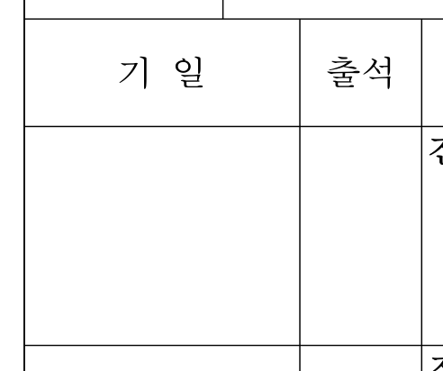
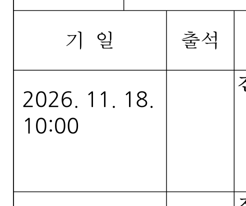

# 첫기일 날짜·시간 선택 입력

기준 커밋: `6b6e718`. 새 작업 브랜치: `experiment/v1-first-hearing`.
기존 `experiment/v1-auto-latest-pdf`에는 변경을 푸시하지 않는다. 2026-11-17.

## 기능과 경계

첫기일 날짜·시간 두 입력만 추가했다. 공소장 정보 입력창은 없다.
날짜는 `YYYY-MM-DD`, 시간은 24시간제 `HH:mm`으로 받으며 하나의 첫기일 항목으로 취급한다.
PDF에는 `2026. 11. 18.` 및 `10:00`을 정확히 두 줄로 출력한다.

둘 다 비우면 종전처럼 생성하고 기일 칸은 비워 둔다. 하나만 입력하거나 존재하지 않는 날짜,
범위를 벗어난 시간, 지원 형식과 다른 입력은 화면에 오류를 표시하고 생성을 막는다.
날짜의 유효성은 기존 순수 calendar 검사 함수 `validDate`를 사용한다. 공소장 파서는 수정하지 않았다.

PDF 선택 전에 입력한 값은 파일 선택·문서 분석 동안 유지된다. 분석 도중 편집하면 생성 시점의
최신 값을 사용한다. PDF 렌더링/로딩이 진행 중일 때 편집한 경우 revision을 비교해 이전 설정의
결과를 게시하지 않는다. 이미 생성한 메모를 보고 있을 때 값을 편집하면 출력·저장 버튼을
무효화하고 공소장 화면으로 돌아간다. 다시 '문서 분석'을 실행해 새 PDF를 생성한다.
이전에 사용자가 다운로드한 디스크 파일을 삭제하지 않는다.

## 실제 원본 양식 측정

저장소 원본 `형사메모.pdf`를 PyMuPDF로 렌더링하고 텍스트 위치와 vector drawing의
표 선을 읽었다. 좌표 기준은 `services.js`와 동일한 페이지 좌상단 pt이다.

| 대상 | 좌표/경계 |
|---|---|
| 원본 페이지 | 595.0001 × 841.0001 pt, 회전 없음 |
| 인쇄된 `기 일` 글자 bbox | x=55.5299..80.4764, y=520.1959..530.6823 |
| 기일 제목 아래 첫 데이터 행 | x=29.7440..106.2630, y=540.1292..600.9031 |
| 새 `boxes.firstHearing` | `[34, 548, 67, 42]` (x, y, 폭, 높이) |

다른 항목 좌표를 재사용하지 않았다. 측정한 셀 경계에 여백을 둔 전용 박스이다.
기존 표 선이나 인쇄 글자를 다시 그리거나 지우지 않고 값만 오버레이한다.
기존 글꼴과 크기 맞춤 규칙(11~8pt)을 사용하되, 첫기일 날짜가 세 줄 이상으로 줄바꿈되지
않도록 두 원문 줄의 폭을 먼저 확인하고 글자 크기를 조정한다.

원본 렌더:

최종 브라우저 다운로드 PDF 렌더:

위 이미지는 가상 공소장으로 생성한 실제 메모 PDF를 독립 PDF 엔진으로 렌더링한 것이다.

## 실행한 검사

- `npm test`: **107개 통과** (기존 93개 + 첫기일 14개).
  선택 입력·정확한 두 줄 형식·윤일·유효 연도·부분 입력·잘못된 날짜/시간을 검사한다.
- `npm run test:built-compatibility`: **2개 통과**. 기존 Edge 104 target 및 PDF.js legacy
  본체/worker의 사전 호환 초기화, 단일 HTML 구조 유지.
- `npm run test:browser`: 두 환경에서 통과했다.
  1. Linux Chromium **103.0.5058.0**의 실제 `file://`, native offline 모드.
  2. Chromium 156에서 Promise.withResolvers 등 새 API를 명시적으로 제거한 환경.
     해당 실행 파일의 file URL은 관리 정책으로 차단되어 동일 HTML의 메모리 진단을 수행했다.
- 기존 샘플 2개와 국선·일반·법무법인 26개 가상 사례, 스캔/혼합 PDF OCR 회귀 통과.
  기존 `verify_outputs.py`의 **150개 PDF 검사**도 각 환경에서 통과했다.
- 첫기일 입력 후 PDF 선택 → 분석을 잠시 보류해 값 유지 확인 → 실제 분석/렌더링/다운로드.
  `2026-11-18 / 10:00`이 PDF의 두 줄로 출력되는지 확인했다.
- 분석 도중 시간을 수정한 값이 유지되어 `2026. 11. 19.` 및 `11:30`으로 출력되는지 확인했다.
- 입력 변경 즉시 이전 출력과 저장 버튼이 비활성화되는지, 부분 입력·잘못된 날짜/시간이
  화면 오류와 생성 차단으로 이어지는지 확인했다. 오류를 바로잡으면 오류 표시도 해제된다.
- PDF 렌더링을 보류한 사이에 값을 수정하고 재개해도 이전 결과가 표시되지 않는지 검사했다.
  재분석 후 최신 `2026. 12. 1.` 및 `09:15`를 출력했다.
- `python scripts/verify_first_hearing.py`: **39개 통과**, 각 환경에서 실행했다.
  실제 다운로드 PDF의 1페이지·정확한 두 줄·글자 bbox가 기일 칸 안에 들어가는지 검사했다.
  원본 제목·상하좌우 표 선 픽셀 보존, 기일 박스 밖의 다른 메모 내용 변경 픽셀 0을 확인했다.
  두 값을 지웠을 때 원본 기일 칸이 빈 상태로 유지되는 것도 확인했다.
- 모든 브라우저 실행에서 외부 HTTP 요청과 페이지 오류는 0이었다.

기록:
- `first-hearing-chromium103-browser-report.json` / `first-hearing-chromium103-pdf-report.json`
- `first-hearing-missing-api-browser-report.json` / `first-hearing-missing-api-pdf-report.json`

## 보존 및 배포

`src/core.js`의 기존 공소장 파서·변호인 규칙은 기준 커밋과 동일하다.
OCR 및 PDF 입력/텍스트 추출 클래스도 동일하며, 원본 PDF·내장 글꼴·OCR 데이터·
PDF.js legacy/Edge 104 빌드 설정은 보존한다. 신규 첫기일 규칙은 별도 `first-hearing.js`에 있다.

새 브랜치에 한해 Actions를 실행하고 `CriminalMemo-first-hearing` ZIP을 업로드한다.
압축 해제 후 `CriminalMemo.html`을 실행하며, 사용자 PC에 서버·인터넷·설치 프로그램을
요구하지 않는다. 기존 자동 추출 브랜치 및 해당 배포본은 보존된다.

## 한계

**실제 회사 Windows Edge 104.0.1293.47에서는 시험하지 못했다.** Chromium 103의
구형 엔진/file 실행과 최신 브라우저의 API 제거 시험을 실제 Edge 104 성공으로 단정하지 않는다.
구형 Linux headless 시험의 SwiftShader 구성은 개발 환경에만 쓰며 배포/회사 PC 요구 사항이 아니다.
보안 기능 비활성화나 file 접근 정책 우회는 사용하지 않는다.

첫기일 기능과 기존 샘플/가상 자료를 검증한 결과이며, 모든 실제 공소장 자동 추출의
정확도를 보장하는 결과는 아니다.
