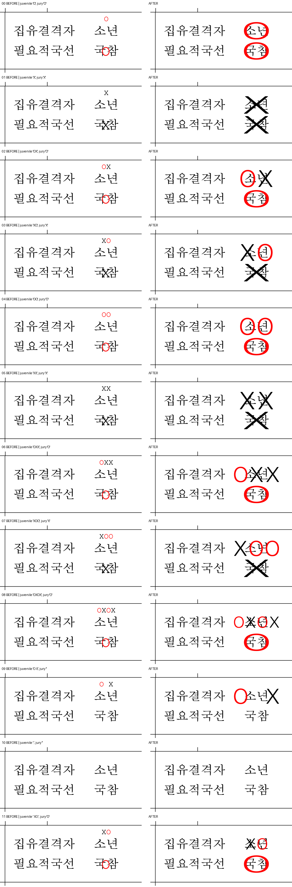
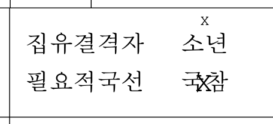
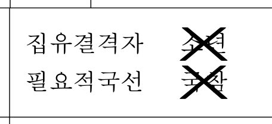
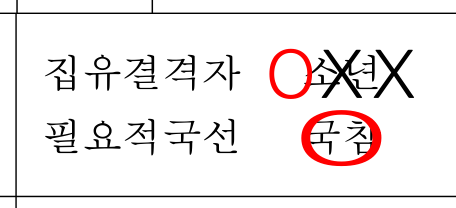
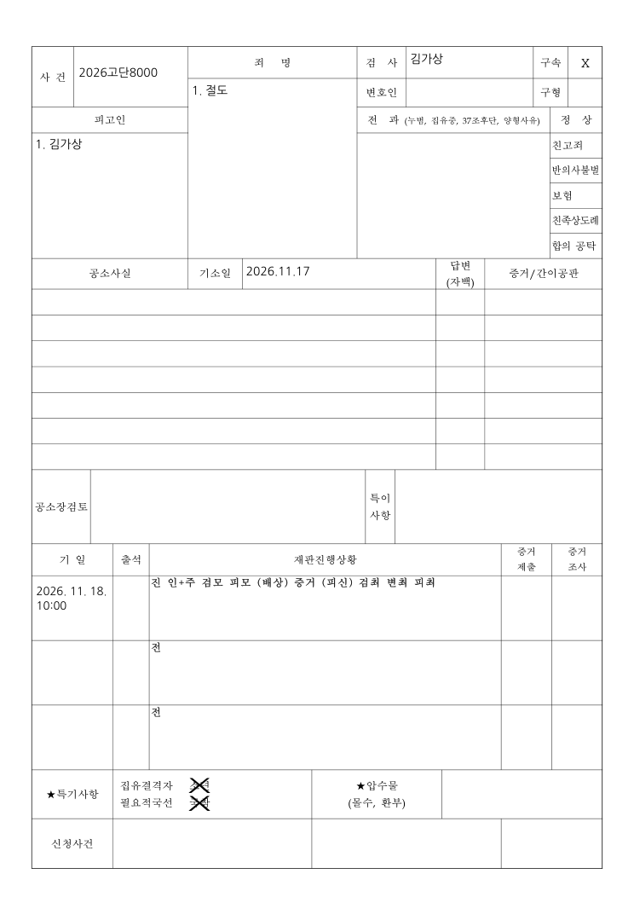
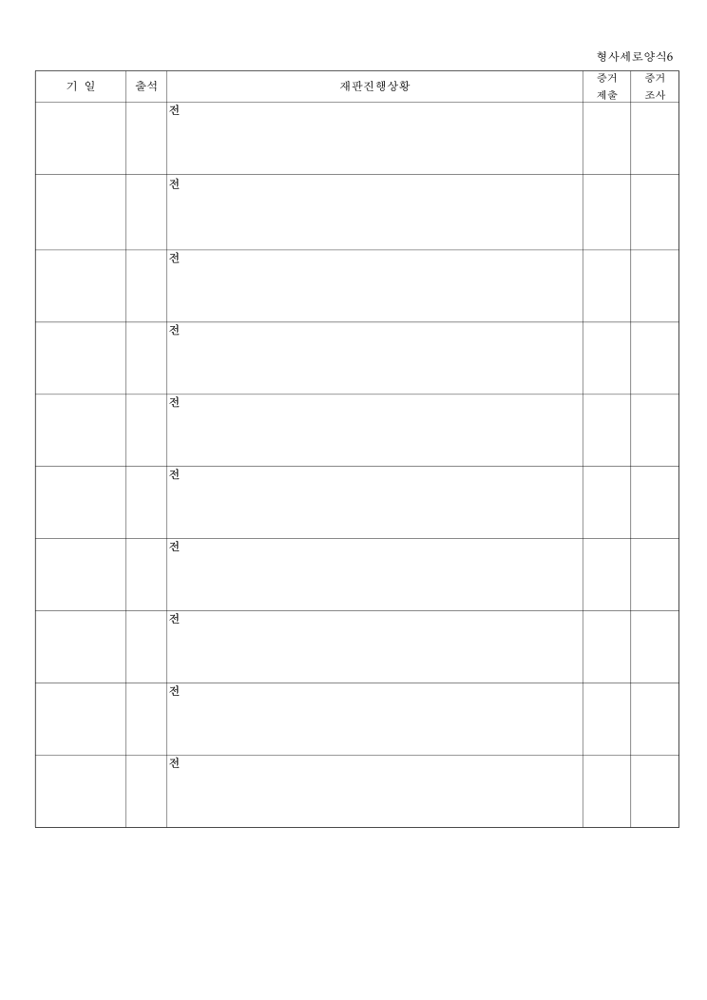

# 소년·국참 출력 레이아웃 수정

기준 `experiment/v1-download-juvenile-jury` / `0cd1af1`에서 같은 브랜치로 작업했다.
이번 변경은 PDF 표시 크기·위치에 한정한다.

## 원인

기존 소년 박스는 인쇄된 소년 글자가 아닌 위쪽 빈 공간 `[168,723.5,39,8]`이었다.
높이 8pt를 `fontSize * 1.249`로 검사하면서 폰트가 6.25pt까지만 허용되었고,
실제 X의 획은 약 3.25 × 3.5pt로 인쇄 글자 위에 첨자처럼 나타났다.
국참도 높이 15pt에서 폰트 전체 높이를 기준으로 맞춰 12pt Courier의 실제 X는 약
6.5 × 6.75pt에 그쳤다. 고정 baseline 보정값 `.932`와 글꼴 전체 ascender/descender는
O/X의 실제 외곽 중심·높이를 나타내지 않는다.

## 출력 전용 auto-fit

`src/mark-layout.js`를 추가하고 기존 구속 OX 출력과 분리했다.

- 원본 PDF의 인쇄 글자 rect를 기준으로 중심을 잡는다.
  소년 `[177.383865,732.124207,20.028656,10.486389]`,
  국참 `[177.383865,748.186707,20.028656,10.486389]` (top-down pt).
- 겹쳐 그릴 안전 영역은 같은 중심의 소년 36 × 14pt, 국참 26 × 14pt다.
  기존 표 선·집유결격자·필요적국선·다른 표시와 겹치지 않는 범위다.
- 새 글꼴을 추가하지 않고 이미 내장된 NanumGothic의 O/X outline bbox를 fontkit으로 읽는다.
  본문과 기존 구속 출력의 글꼴·좌표·계산은 유지한다.
- 폭/높이 제약으로 가능한 최대 폰트 크기를 직접 계산한다. 임의 최대 14pt나
  0.25pt씩 줄이는 반복 계산, 줄 높이/descender 기반 보정을 사용하지 않는다.
- 실제 획의 y 중심으로 baseline을 역산한다. O와 X 각각의 서로 다른 outline을 사용하므로
  X가 위로 뜨지 않는다. 혼합 문자열은 양 끝 획 폭의 차이까지 보정해 전체를 가운데 맞춘다.
- 단독 Latin O/X는 높이를 맞춰도 한글 두 글자보다 폭이 좁으므로 그 표시만
  가로로 확장해 인쇄된 두 글자 폭까지 덮는다. 주변 페이지 변환은 q/Q로 분리한다.
- 복수 피고인은 한 줄의 동일 간격 슬롯을 유지하면서 폭이 부족하면 자동 축소한다.
  3자 OXX/XOO도 실제 높이가 인쇄 글자 높이를 덮는다. 더 긴 문자열은 칸 폭이 허용하는
  최대 크기로 줄어들며 중앙 위치를 유지한다. 미확정 공백 슬롯과 기존 색상은 보존한다.

수정 후 단독 O/X 폰트는 약 18.16/18.92pt이며 실제 획 크기는 약 **20.1 × 14pt**다.
8배 렌더링에서 실제 획 중심의 가로·세로 오차는 기준 중심으로부터 0.25pt 이내다.
폰트의 텍스트 추출용 bbox가 아닌 실제 래스터 획을 측정했다.

| 표시 | 수정 전 실제 획 | 수정 후 실제 획 |
|---|---|---|
| 소년 O | 약 3.25 × 3.75pt, 글자 위 | 약 20.1 × 14pt, 글자 중앙 |
| 소년 X | 약 3.25 × 3.5pt, 글자 위 | 약 20.1 × 14pt, 글자 중앙 |
| 국참 O | 약 6.25 × 7.25pt | 약 20.1 × 14pt, 글자 중앙 |
| 국참 X | 약 6.5 × 6.75pt | 약 20.1 × 14pt, 글자 중앙 |
| 소년 OX | 약 7 × 3.75pt, 글자 위 | 약 25.9 × 14pt, 전체 중앙 |

## 전후 스냅샷

왼쪽은 기준 커밋의 실제 HTML 렌더러, 오른쪽은 수정 버전이다. 두 버전에 같은 draft와
사건번호·첫기일을 전달했다. 새 양식을 그리지 않고 기존 실제 원본에 표시했다.

## 검증

- 기존 166개와 레이아웃 15개를 합친 **181개 단위 검사 통과**.
- 사전 폴리필·Edge 104 legacy·원본 양식 내장 검사 **3개 통과**.
- O, X, OX, XO, OO, XX, OXX, XOO, OXOX, O X, 전원 미확정, 양 끝 미확정의 12개 사례.
- 기준/수정 버전의 `juvenileGlyphs()`와 `juryGlyph()` 반환값이 모든 사례에서 동일하다.
- 실제 양식 PDF와 실제 획 측정용 흰 배경 진단 PDF를 각각 전후 생성한 **48개 PDF** 검사.
  흰 배경은 원본 양식을 변경하는 기능이 아니라, 인쇄된 검정 글자와 표시의 검정 X를 분리해
  실제 획을 측정하기 위한 테스트 전용 입력이다.
- 독립 PyMuPDF로 **421개 검사** 통과: 색상·전체 가로 중앙·각 글리프 세로 중앙·크기·칸 범위,
  새 표시 영역 밖 첫 페이지 픽셀 동일, 원본 표/벡터 경로 동일,
  모든 PDF 2페이지 및 두 번째 페이지의 크기·회전·내용 스트림·전체 픽셀 원본 동일.
- Linux Chromium 103의 실제 오프라인 file URL에서 수행했다.
- 최신 Chromium의 Promise.withResolvers 등 API 제거 환경에서도 12개 사례와 421개 검사가 통과했다.
  해당 환경의 file URL은 관리 정책으로 차단되어 동일 HTML의 메모리 진단으로 구분한다.
- 기존 전체 브라우저 회귀도 Chromium 103의 실제 file URL에서 통과했다.
  2건/10건 다운로드, 폴더 저장 모의 핸들, 부분 추출, 검사·기소일·변호인·죄명,
  기존 샘플 2개, 변호인 26개 형식, 이미지/혼합 OCR을 포함해 PDF 54개를 실제 다운로드했다.
- 첫/둘째 페이지 및 전후 스냅샷을 직접 시각 확인했다.

## 보존 범위와 수정 파일

`src/core.js`, `app.js`, `storage.js`, `batch.js`, `first-hearing.js`, UI 원본 HTML은
`0cd1af1`과 바이트 단위로 동일함을 확인했다. 판정·추출·다운로드·파일명·첫기일은 변경하지 않았다.
원본 PDF·글꼴·OCR 자산·라이브러리 버전·Edge 104 빌드 타깃·Actions 구성도 그대로다.

- 제품 코드: `src/mark-layout.js` 신규, `src/services.js`의 소년·국참 그리기와 두 박스만 수정.
- 검사: `tests/mark-layout.test.mjs`, `tests/mark-layout-browser.mjs`, `scripts/verify_mark_layout.py` 신규.
- 개발 검사 명령/이미지 비교 의존성: `package.json`, `scripts/requirements-test.txt`.
  Pillow는 개발용 비교 이미지에만 사용하며 실행 HTML의 의존성은 추가하지 않았다.
- 설명/증거: README, USER_GUIDE의 표시 위치 설명, 이 보고서와 PNG/JSON 결과.
- 빌드 산출물: 단일 HTML, 배포 README, manifest를 재생성했다.

보고서 파일은 `mark-layout-chromium103-*-report.json`, `mark-layout-missing-api-*-report.json`,
`mark-layout-functional-browser-report.json`이다. 각각 시험한 HTML의 SHA-256을 기록한다.
이전 `verify_download_juvenile_jury.py`의 기존 크기/좌표 검사는 당시 레이아웃 전용이다.
현재 출력의 크기/좌표 검사는 `verify_mark_layout.py`를 사용한다.

실제 회사 Windows Edge 104.0.1293.47에서 직접 시험하지는 못했다.
구형 Linux 엔진과 API 제거 시험을 실제 Windows 실행 성공으로 단정하지 않는다.
