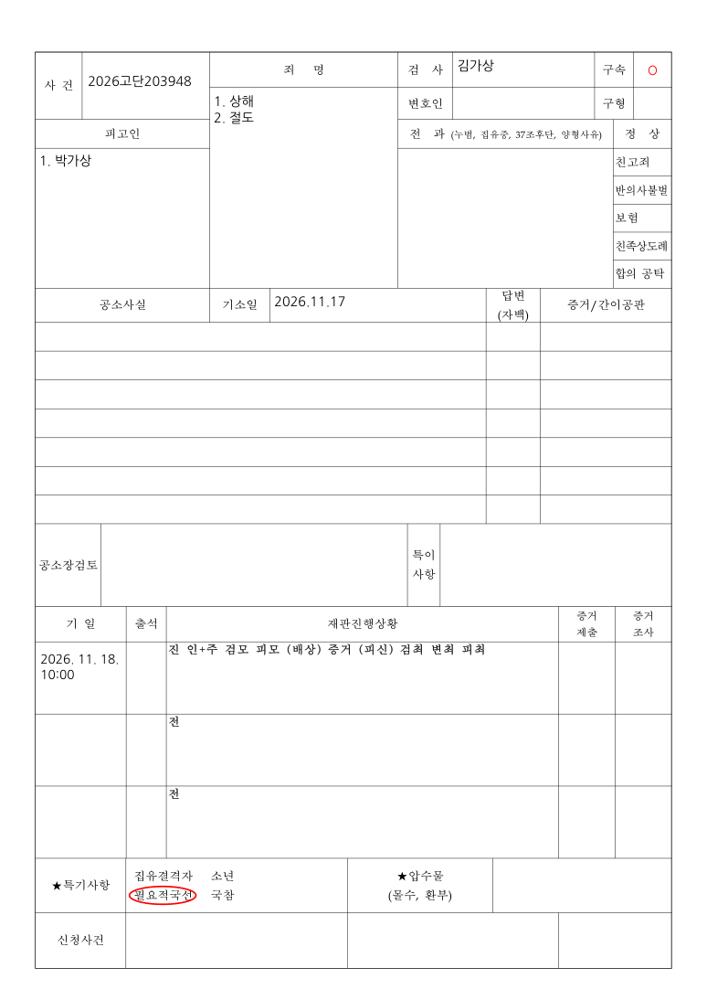
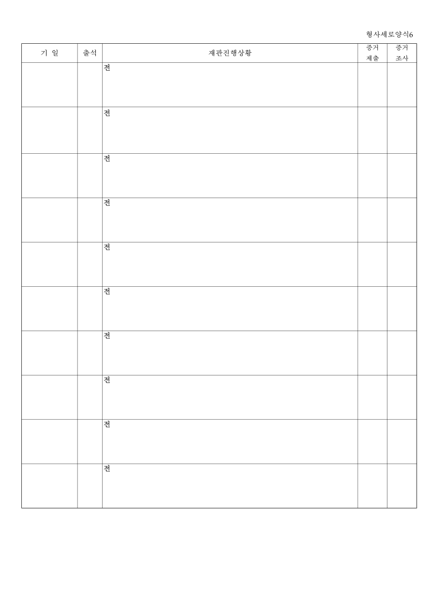
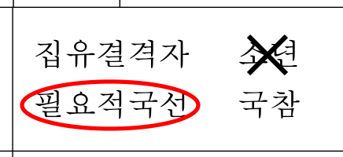

# 2페이지 메모·부분 추출·소년 X·개별 저장

기준 `experiment/v1-batch-case-number` / `f25b9b0`에서 새 브랜치
`experiment/v1-two-page-memo`로 개발했다. 기준 브랜치는 보존한다.

## 실제 두 번째 원본과 PDF 생성

사용자가 첨부한 `형사메모(2쪽).pdf`를 개발 환경에 다운로드하고 실제로 열고 렌더링했다.
`windows/templates/형사메모(2쪽).pdf`로 바이트를 보존한다.

- 1페이지, 약 595 × 841pt, 회전 0.
- SHA-256: `5164a65054179dd49edaf601f009324051f608f8aef0e3d4e0b5d94bccd4b26b`.
- 빌드가 두 원본을 모두 base64로 HTML에 내장한다. 사용자는 별도 PDF를 가져갈 필요가 없다.
- 기존 첫 페이지 기재 후 `pdf-lib.copyPages`로 제공 원본의 첫 페이지를 복사한다.
- 원본마다 1페이지인지 검사하고 최종 PDF를 정확히 2페이지로 만든다. 두 번째 페이지에는 그리기 명령을 추가하지 않는다.
- 배포 ZIP의 원본 사본과 HTML 내장 바이트도 원본과 동일함을 검사한다.

## 추출 실패와 생성 오류의 분리

`validateDraft`는 기존 진단을 그대로 반환한다. UI와 렌더러에서 이를 생성 중단 조건으로 사용하지 않는다.
검사·기소일·이름·죄명 등 파서 반환값이 없으면 비워 두며, 변호인은 `named` 상태만 출력한다.
구속 `unknown`은 빈칸으로 두고 복수 피고인의 해당 위치를 보존한다.
어떤 공소장 정보도 없으면 파일명 사건번호와 사용자가 입력한 첫기일을 기재한다.

- 파일별 추출 경고: 기존 필드별 진단, 파서 경고, 페이지별 텍스트/OCR 실패를 표시한다.
- OCR 엔진·설정은 유지하며 실패한 페이지에서도 이미 얻은 native text와 다른 페이지 정보를 보존한다.
- PDF 열기/페이지 읽기 불가, 파일명 사건번호 오류, 필수 첫기일 오류, 내장 양식 오류와 실제 출력 불가는 생성 오류로 구분한다.
- 한 파일 오류가 다음 파일을 중단하지 않는다. 생성 결과가 없으면 저장 버튼을 활성화하지 않는다.
- 첫기일 날짜·시간의 기존 필수 입력과 저장 파일명 규칙은 유지한다. '정보 없음'은 공소장 자동 추출 항목을 뜻한다.
- 입력 변경 시 결과를 무효화하며, 분석 도중 변경한 결과를 게시하지 않는 기존 revision 검증을 유지한다.

검사·기소일·피고인·죄명·변호인·구속 파서 클래스, PDFInputService/PDFTextExtractor/OCRService
클래스 본문은 `f25b9b0`과 동일함을 직접 비교했다. 변경은 생성 정책, 분석 실패 수집, 표시·저장에 한정한다.

## 소년 표시

기존 출생 세기 판정과 나이 계산을 그대로 사용한다. 주민번호 앞 6자리와 일치하는 명시적 전체 생년월일
근거가 없으면 나이는 미확정이다. 뒷자리·기재 나이·임의 세기 기준을 사용하지 않는다.

- 한 명이라도 확정 만 19세 미만: 기존 빨간 동그라미.
- 피고인이 한 명 이상이고 **전원이** 확정 만 19세 이상: 같은 측정 중심에서 검정 두 대각선 X.
- 그 외: 표시 없음. 성인+미확정은 빈칸, 소년+미확정은 소년 동그라미를 우선한다.
- 기소일 미확정도 나이 표시를 보류한다. 필요적국선의 구속 또는 확정 70세 이상 규칙은 변경하지 않는다.

## 개별 저장과 폴더 선택

메모용 ZIP 생성 함수·직접 fflate 의존성을 제거했다. 단건·다건 모두 `HHmm 사건번호.pdf`를 각각 생성한다.
각 행의 개별 다운로드 버튼과 전체 개별 다운로드 버튼을 제공한다.
전체 버튼은 브라우저에 다운로드를 요청할 뿐, 차단될 수 있으므로 **다운로드 요청됨**으로만 표시한다.
실제 폴더 쓰기·닫기가 성공한 경우에만 **폴더 저장 완료**로 표시한다.

`showDirectoryPicker({mode:'readwrite'})`는 저장 폴더 선택 버튼의 사용자 동작에서만 호출한다.
선택 자체는 쓰지 않으며, 폴더 저장 버튼에서 권한을 확인한 뒤 사건별로 기록한다.
입력 File의 경로를 추론하거나 기존 공소장을 삭제·수정하지 않는다.
기존 이름을 먼저 조회해 존재하면 쓰기 스트림을 열지 않고 충돌 오류를 표시한다.
File System Access API에는 원자적 create-exclusive가 없어, 다른 프로그램이 검사 직후 같은 이름을
동시에 만드는 경우까지 보장하는 잠금은 없다. 동일 폴더에 대한 동시 외부 쓰기는 피해야 한다.
권한 거부·정책 차단·미지원은 폴더 상태에 표시하고 개별 다운로드로 전환할 수 있게 한다.

### Edge 104와 file 실행 검증 범위

[MDN 호환성 데이터](https://github.com/mdn/browser-compat-data/blob/main/api/Window.json)의
`showDirectoryPicker`는 Chromium 86부터, Edge는 Chromium 지원을 따른다.
`FileSystemFileHandle.createWritable` 및 `FileSystemHandle.requestPermission`도 Chromium 86부터다.
따라서 Edge 104의 API 범위에 해당한다. 다만 제공 여부와 폴더 권한 허용은 별개이다.
[API 문서](https://developer.mozilla.org/en-US/docs/Web/API/Window/showDirectoryPicker)는
보안 컨텍스트·사용자 동작을 요구한다. 회사의 파일 접근 정책·권한에 의해 제한될 수 있다.

실제 Linux Chromium 103의 오프라인 `file://`에서 `isSecureContext=true`, picker 함수 제공을 확인했다.
네이티브 선택 호출은 headless 환경에서 `AbortError`로 종료되어 **실제 폴더 선택/저장은 검증하지 못했다**.
폴더 저장의 10개 파일 전체 바이트, 충돌 시 원본 보존, 권한·정책 거부와 미지원 대체 흐름은
사용자 선택을 재현한 picker/handle 모의 객체로 테스트했다. 이 결과는 실제 회사 폴더 접근 검증이 아니다.
일부 자동 다중 다운로드가 실제로 전부 수신되지 않는 경우도 관찰되어 완료로 표시하지 않는다.
Chromium 103 실제 file 환경에서는 각 행의 10개 개별 버튼으로 파일명·내용을 모두 다운로드하여 확인했다.
최신 Chromium은 file URL과 메모리 진단의 반복 다운로드가 정책으로 차단될 수 있다. 차단된 요청은
실제 저장 성공으로 계산하지 않고, 해당 다운로드 호출에 전달된 PDF 바이트를 관찰한 메모리 진단으로 구분한다.
폴더 UI의 모의 핸들 검사는 보안 컨텍스트인 Chromium 103에서 수행하며, 보안 컨텍스트가 아닌 메모리 진단에서는 거절과 대체 다운로드 요청만 검사한다.

**회사 Windows Edge 104.0.1293.47의 네이티브 폴더 선택/쓰기와 관리 정책은 미검증이다.**
회사 PC에서 제한되면 사건별 다운로드를 사용한다. 보안 기능 해제나 정책 우회를 요구하지 않는다.

## 검증

- 기존 파서·첫기일·구속·나이 회귀를 포함한 단위 테스트 **149개 통과**.
  이전 ZIP 전용 검사는 요구 변경에 따라 제거하고 개별 폴더 저장 검사로 대체했다.
- 완성 HTML의 사전 폴리필/Edge 104 legacy 빌드 및 원본 내장 검사 **3개 통과**.
- 구형 Linux Chromium 103 실제 오프라인 file URL, 최신 Chromium API 제거 환경에서 UI 흐름을 검사한다.
  최신 Chromium에서 file URL이 관리 정책으로 차단되면 동일 HTML의 메모리 진단임을 보고서에 명시한다.
- 10건 다중 선택, 날짜만 복사, 시간 개별 유지, 이름 규칙, 생성 무효화·분석 중 수정, 중복 이름 방지.
- 사건번호 누락·손상 PDF와 정상 파일을 섞어 오류 격리, 단건 및 개별 다건 다운로드.
- 검사 누락, 변호인 needsReview, 구속 unknown, 정보 전무, 빈 PDF OCR 실패도 경고 후 생성.
- 원본 오류는 실패로 구분하고 복구 후 다시 생성. 다른 수동 입력 항목 없음.
- 기존 실제 샘플 2개의 추출 결과를 기존 fixture와 비교, 국선/일반/법무법인 26개 형식의 최종 PDF 검사.
- 실제 이미지 전용·text/image 혼합 PDF의 OCR 추출과 검토 상태가 유지됨을 확인한다.
  이번 변경에서는 해당 검토 상태가 생성 중단 대신 경고·빈칸으로 이어진다.
- 독립 PyMuPDF로 각 환경의 **54개 PDF / 412개 검사** (Chromium 103은 실제 브라우저 다운로드,
  최신 Chromium의 차단 요청은 명시된 메모리 진단 바이트):
  모든 PDF 정확히 2페이지, 두 번째 페이지의 크기·회전·텍스트/글꼴/좌표·내용 스트림·전체 픽셀 원본 동일.
  동일 draft와 옵션으로 기준 커밋의 실제 HTML 렌더러가 만든 첫 페이지와 비교하여 소년 X 영역 외 픽셀 차이 0.
  사건·첫기일·구속·변호인 전체 이름, 추출 실패 칸 비어 있음, 소년 X/원/보류를 확인한다.
- 두 페이지와 소년 X를 이미지로 렌더링하고 직접 시각 확인했다.

보고서: `two-page-chromium103-browser-report.json`, `two-page-chromium103-pdf-report.json`,
`two-page-missing-api-browser-report.json`, `two-page-missing-api-pdf-report.json`.
각 보고서는 시험한 HTML의 SHA-256과 실제 검증 범위를 기록한다.
가상 자료 및 기존 샘플의 성공을 최신 실제 공소장 전체의 정확도 보장으로 해석하지 않는다.
